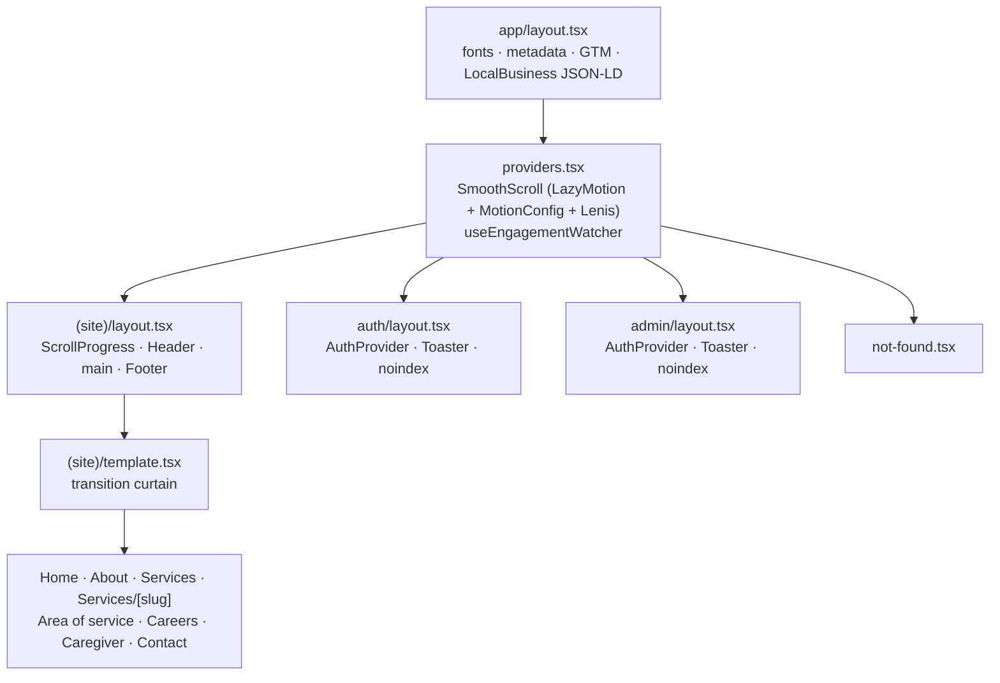
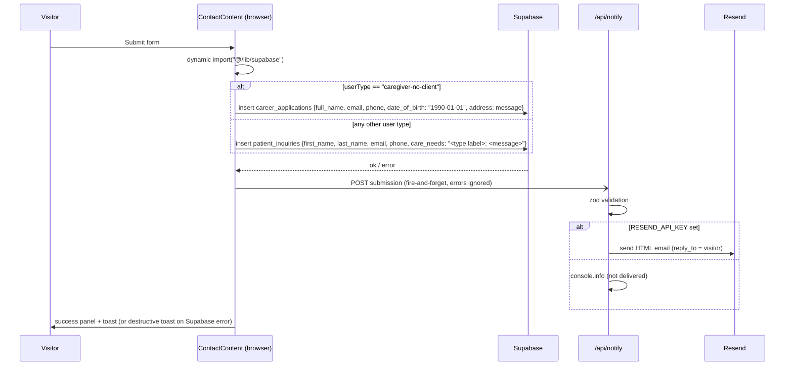

# Carenest Homecare — Website & Admin Portal

The public marketing website and internal admin portal for **[Carenest Homecare](https://carenesthc.com)**, a locally owned,
non-medical in-home care agency serving **Cook, Lake and DuPage counties** in Illinois (Chicagoland).

The site is built with the **Next.js 16 App Router** and **React 19**. It uses a motion-heavy design system (smooth scrolling,
scroll-linked sections, glass surfaces, page transitions) and still loads fast and ranks well in search: CSS-only hero
animations, lazy-loaded animation code, optimised images, full structured data and strict security headers.
Form submissions go to **Supabase**, and staff manage them in a small, role-protected **admin dashboard**.

---

## Table of contents

1. [Features at a glance](#1-features-at-a-glance)
2. [Tech stack](#2-tech-stack)
3. [Getting started](#3-getting-started)
4. [Environment variables](#4-environment-variables)
5. [Project structure](#5-project-structure)
6. [Architecture](#6-architecture)
7. [Routes and pages](#7-routes-and-pages)
8. [Content and data model](#8-content-and-data-model)
9. [Backend: Supabase, auth and the admin portal](#9-backend-supabase-auth-and-the-admin-portal)
10. [API: `/api/notify`](#10-api-apinotify)
11. [Design system](#11-design-system)
12. [Motion system](#12-motion-system)
13. [Component reference](#13-component-reference)
14. [Hooks and utilities](#14-hooks-and-utilities)
15. [SEO](#15-seo)
16. [Performance](#16-performance)
17. [Security](#17-security)
18. [Accessibility](#18-accessibility)
19. [How-to guides](#19-how-to-guides)
20. [Deployment](#20-deployment)
21. [Known limitations and notes](#21-known-limitations-and-notes)

---

## 1. Features at a glance

**Public website**

- Eight marketing routes (14 pages in total): home, about, services overview, **7 statically generated service pages**,
  areas of service, careers, caregiver job page and contact.
- A full-bleed photo banner on every page, with a Ken Burns zoom, scroll parallax and (on the home page) a cross-fading slideshow with progress controls.
- Scroll-driven storytelling: sticky stacking cards, a pinned horizontal card stack, a scroll-drawn timeline, word-by-word text reveal and expanding service panels.
- An interactive **Illinois county map** (d3-geo) that highlights the service area and stays in sync with the county cards.
- A contact form with radio-card audience selection. Submissions are stored in Supabase, with optional email notification through Resend.
- A branded page-transition curtain on client-side navigation, a scroll progress bar, a hide-on-scroll header, a services mega menu and a full-screen mobile menu.

**Admin portal** (`/auth`, `/admin`)

- Supabase email/password authentication.
- A role-gated dashboard (`admin` or `staff`) listing **patient inquiries** and **career applications**, with inline status changes.
- Staff management: grant `staff`/`admin` roles by Supabase user ID.

**Quality**

- Per-page metadata, canonical URLs, Open Graph and Twitter cards, and JSON-LD (LocalBusiness, WebSite, BreadcrumbList, Service, FAQPage).
- Generated `sitemap.xml`, `robots.txt` and `llms.txt`.
- Content-Security-Policy, HSTS and other hardening headers.
- Respects `prefers-reduced-motion` throughout. Ambient animations wait for the visitor's first interaction.

---

## 2. Tech stack

| Area | Technology | Version (package.json) |
|---|---|---|
| Framework | [Next.js](https://nextjs.org) App Router (Turbopack dev server) | `^16.4.6` |
| UI runtime | React / React DOM | `^19.3.1` |
| Language | TypeScript (strict) | `^6.0.3` |
| Styling | Tailwind CSS v4 (`@tailwindcss/postcss`), `tw-animate-css` | `^4.3.5`, `^1.4.0` |
| Class helpers | `clsx`, `tailwind-merge`, `class-variance-authority` | `^2.1.1`, `^3.7.0`, `^0.7.1` |
| UI primitives | Radix UI: Accordion, Label, Select, Slot, Tabs, Toast | see package.json |
| Animation | [`motion`](https://motion.dev) (Framer Motion), loaded via `LazyMotion` | `^14.12.0` |
| Smooth scroll | [`lenis`](https://lenis.darkroom.engineering) | `^1.3.27` |
| Icons | `lucide-react` plus a custom Instagram glyph | `^1.71.0` |
| Map | `d3-geo` with pre-extracted GeoJSON | `^3.1.2` |
| Backend | `@supabase/supabase-js` (auth + Postgres) | `^2.119.0` |
| Validation | `zod` | `^4.6.7` |
| Images (build time) | `sharp`: generates the responsive WebP variants (dev dependency) | `^0.35.5` |
| Dates | `date-fns` | `^4.4.0` |
| Analytics (optional) | `@next/third-parties` (Google Tag Manager) | `^16.4.6` |
| Email (optional) | [Resend](https://resend.com) REST API (called with `fetch`, no SDK) | — |
| Linting | ESLint 10 with `eslint-config-next` (core-web-vitals + typescript) | `^10.14.0` |
| Fonts | Plus Jakarta Sans (body/display), Instrument Serif italic (accents) via `next/font/google` | — |

---

## 3. Getting started

### Prerequisites

- **Node.js 20.9 or newer** (required by Next.js 16) and npm.
- Access to the Supabase project (the public URL and anon key are already in `.env.example`).

### Install and run

```bash
npm install
cp .env.example .env.local     # then adjust values (see below)
npm run dev                    # http://localhost:3000
```

### Scripts

| Command | What it does |
|---|---|
| `npm run dev` | Start the development server with hot reload (runs `npm run images` first). |
| `npm run build` | Production build (runs `npm run images` first; static generation of all marketing pages, service pages and `llms.txt`). |
| `npm run images` | Generate responsive WebP variants, social JPEGs and the image manifest from `public/assets/*.webp` (§16.1). |
| `npm start` | Serve the production build. |
| `npm run lint` | Run ESLint over the whole project. |

There is no automated test suite in this repository.

---

## 4. Environment variables

All variables are optional for local development. Without them the app falls back to sensible defaults. Copy
`.env.example` to `.env.local`. Both `.env` and `.env*.local` are git-ignored.

| Variable | Used in | Purpose | Default when unset |
|---|---|---|---|
| `NEXT_PUBLIC_SUPABASE_URL` | `src/lib/supabase.ts` | Supabase project URL (browser-safe). | Hard-coded project URL |
| `NEXT_PUBLIC_SUPABASE_ANON_KEY` | `src/lib/supabase.ts` | Supabase **public anon** key (browser-safe; access is enforced by Row Level Security). | Hard-coded anon key |
| `RESEND_API_KEY` | `src/app/api/notify/route.ts` | Enables emailing new form submissions through Resend. | Submissions are only logged on the server |
| `NOTIFY_EMAIL_TO` | `/api/notify` | Recipient(s); a comma-separated list is supported. | `info@carenesthc.com` |
| `NOTIFY_EMAIL_FROM` | `/api/notify` | Sender, e.g. `Carenest Website <notifications@carenesthc.com>` (domain must be verified in Resend). | `Carenest Website <onboarding@resend.dev>` |
| `NEXT_PUBLIC_SITE_URL` | `src/lib/site.ts` | Canonical origin for canonical links, Open Graph URLs, sitemap, robots and llms.txt. | Vercel production domain, then `https://carenesthc.com` |
| `NEXT_PUBLIC_GTM_ID` | `src/app/layout.tsx` | Google Tag Manager container ID (`GTM-XXXXXXX`). When empty, no tracking script loads. | No GTM |

`SITE_URL` is resolved in this order: `NEXT_PUBLIC_SITE_URL` → `NEXT_PUBLIC_VERCEL_PROJECT_PRODUCTION_URL` /
`VERCEL_PROJECT_PRODUCTION_URL` (set automatically by Vercel) → `https://carenesthc.com`. A trailing slash is always stripped.

---

## 5. Project structure

```
.
├── next.config.ts              Security headers, CSP, cache headers, /consultation redirect
├── scripts/optimize-images.mjs Build-time image pipeline (WebP variants, OG JPEGs, manifest; see §16.1)
├── eslint.config.mjs           Next core-web-vitals + TypeScript rules (no-img-element disabled, see §16)
├── postcss.config.mjs          Tailwind v4 PostCSS plugin
├── tsconfig.json               Strict TS, bundler resolution, "@/*" → "./src/*"
├── .env.example                Documented environment variables
├── public/
│   ├── assets/                 13 WebP masters (12 photos + logo); r/ holds generated variants (git-ignored)
│   ├── data/
│   │   ├── illinois-counties.json   Pre-extracted GeoJSON: 102 Illinois counties + Illinois & neighbouring states
│   │   └── states-10m.json          Source US-states TopoJSON (not referenced by the code)
│   ├── favicon.ico, favicon.png, apple-touch-icon.png
│   └── og-image.png            Default 1200×630 social preview image
└── src/
    ├── app/
    │   ├── layout.tsx          Root layout: fonts, global metadata, viewport, GTM, LocalBusiness JSON-LD, <Providers>
    │   ├── providers.tsx       Client providers: SmoothScroll (Lenis + LazyMotion) and the engagement watcher
    │   ├── globals.css         Design tokens, Tailwind theme, keyframes, custom utilities
    │   ├── not-found.tsx       Branded 404 page
    │   ├── robots.ts           /robots.txt
    │   ├── sitemap.ts          /sitemap.xml
    │   ├── llms.txt/route.ts   /llms.txt (statically generated)
    │   ├── api/notify/route.ts POST endpoint: validates and emails form submissions
    │   ├── (site)/             Route group for marketing pages (shared header/footer/progress bar)
    │   │   ├── layout.tsx      ScrollProgress + Header + <main id="main"> + Footer
    │   │   ├── template.tsx    Page-transition curtain (client-side navigations only)
    │   │   ├── page.tsx        Home
    │   │   ├── about/          page.tsx (server, metadata) + AboutContent.tsx (client)
    │   │   ├── services/       page.tsx + ServicesContent.tsx, and [slug]/page.tsx (7 static pages)
    │   │   ├── area-of-service/ page.tsx + AreaContent.tsx
    │   │   ├── careers/        page.tsx + CareersContent.tsx, and caregiver/ (page.tsx + CaregiverContent.tsx)
    │   │   └── contact/        page.tsx + ContactContent.tsx (form)
    │   ├── auth/               Admin sign-in / sign-up (layout adds AuthProvider + Toaster, noindex)
    │   └── admin/              Admin dashboard (layout adds AuthProvider + Toaster, noindex)
    ├── components/
    │   ├── fx/                 Reusable motion primitives (Reveal, StackingCards, HorizontalStack, Marquee, …)
    │   ├── layout/             Header, Footer, Logo
    │   ├── sections/           PageHero, BannerMedia, HeroLines, CTASection, FaqSection, FaqList, ServiceArea
    │   ├── home/               Home-page sections (HomeHero, StatsBand, ProblemsStack, …)
    │   ├── services/           ServicePageTemplate, ServiceRevealCard, service-data.ts (service page content)
    │   ├── careers/            HiringProcess
    │   ├── maps/               IllinoisMap (d3-geo)
    │   ├── admin/              StaffManagement
    │   ├── seo/                JsonLd
    │   ├── icons/              lucide-react re-export + custom Instagram icon factory
    │   └── ui/                 shadcn-style primitives (button, input, select, tabs, table, toast, img, …)
    ├── content/site.ts         All page copy and lists (services, FAQs, testimonials, stats, careers, …)
    ├── contexts/AuthContext.tsx Supabase session + admin-role state
    ├── hooks/                  use-media-query, use-toast, use-user-engaged
    └── lib/
        ├── site.ts             SITE constants (name, phone, email, address, links) and SITE_URL
        ├── images.ts           Site images with alt text (IMAGES), built from the manifest
        ├── image-manifest.ts   GENERATED by scripts/optimize-images.mjs (sizes, variants, placeholders)
        ├── seo.ts              pageMetadata() and JSON-LD builders
        ├── supabase.ts         Lazily created browser Supabase client
        ├── motion-features.ts  domMax feature bundle for LazyMotion
        └── utils.ts            cn() class-name helper
```

---

## 6. Architecture

### 6.1 Rendering model

Every marketing route follows the same two-file pattern:

- **`page.tsx`**, a server component. It exports static `metadata` (built with `pageMetadata()`), renders JSON-LD with
  `<JsonLd>`, and renders the page's content component.
- **`*Content.tsx`**, a client component (`"use client"`) that holds the interactive, animated page body.

Because the content components are still server-rendered, the full HTML (including all copy and FAQ answers) is
available to crawlers before hydration. Hero banners (`HomeHero`, `PageHero`, `HeroLines`) are **server components**
that animate with CSS only, so the largest text and image paint without waiting for JavaScript.

On the home page, every section below the fold is loaded with `next/dynamic`. It is still server-rendered, but each
section hydrates from its own chunk instead of one long main-thread task.

### 6.2 Layout tree



- **Root layout.** Loads the fonts (`--font-jakarta`, `--font-instrument`) and sets site-wide default metadata (title
  template `"%s | Carenest Homecare"`, icons, Open Graph, Twitter). It also sets the viewport `themeColor: #f9f7f3`,
  injects GTM when `NEXT_PUBLIC_GTM_ID` is set and renders the LocalBusiness JSON-LD once.
- **Providers.** `SmoothScroll` wraps the app in `LazyMotion` (strict mode, so only the lightweight `m.*` components
  are allowed and the `domMax` feature bundle downloads asynchronously). It also adds `MotionConfig reducedMotion="user"`
  and, unless the user prefers reduced motion, Lenis smooth scrolling. `RouteScrollReset` jumps to the top on every
  pathname change.
- **`(site)` route group.** Shares the header, footer and scroll progress bar without affecting URLs. `/auth`, `/admin`
  and the 404 page sit outside it, so they render without the marketing chrome.
- **Auth/admin layouts.** These scope the Supabase `AuthProvider` and the toast `Toaster` to the portal, so the public
  site never loads Supabase up front.

### 6.3 Page transitions (`(site)/template.tsx`)

A Next.js `template` re-mounts on every navigation. A module-level `hasHydrated` flag distinguishes the **first page
load**, which renders immediately with no hidden content so LCP is never delayed, from **later client-side
navigations**. On those, a brand-gradient curtain with the logo sweeps upward (`clip-path` inset animation) while the
new page fades and rises in.

---

## 7. Routes and pages

| Route | Type | Source |
|---|---|---|
| `/` | Static | `src/app/(site)/page.tsx` |
| `/about` | Static | `src/app/(site)/about/` |
| `/services` | Static | `src/app/(site)/services/page.tsx` |
| `/services/[slug]` | SSG (`generateStaticParams`, `dynamicParams = false`) | `src/app/(site)/services/[slug]/page.tsx` |
| `/area-of-service` | Static | `src/app/(site)/area-of-service/` |
| `/careers` | Static | `src/app/(site)/careers/` |
| `/careers/caregiver` | Static | `src/app/(site)/careers/caregiver/` |
| `/contact` | Static | `src/app/(site)/contact/` |
| `/auth` | Client page, `noindex` | `src/app/auth/page.tsx` |
| `/admin` | Client page, `noindex` | `src/app/admin/page.tsx` |
| `/consultation` | Redirect to `/contact` (temporary, 307) | `next.config.ts` |
| `/api/notify` | `POST` route handler | `src/app/api/notify/route.ts` |
| `/sitemap.xml`, `/robots.txt` | Metadata routes | `src/app/sitemap.ts`, `src/app/robots.ts` |
| `/llms.txt` | Static route handler (`force-static`) | `src/app/llms.txt/route.ts` |
| any unknown path | 404 | `src/app/not-found.tsx` |

Service slugs (7): `senior-care`, `personal-care`, `companion-care`, `24-hour-care`, `alzheimer-care`, `dementia-care`,
`traditional-home-care`. Any other slug returns a 404.

### 7.1 Home (`/`)

Sections, in order:

1. **`HomeHero`**: a four-photo `BannerMedia` slideshow (6 s per slide, with progress tabs, counter and prev/next).
   It has a "Welcome to Carenest · Cook · Lake · DuPage" pill with a pinging dot, and a three-line masked headline
   ("Your loved one / deserves care that / feels like *family*"). Below that are the CTAs **Call or Text Today**
   (`tel:`) and **Explore home care services**, a trust list (licensed/bonded/insured, free consultation, locally
   owned) and a marquee of service pills.
2. **`StatsBand`**: four count-up counters: 6 specialised services, 3 counties, 24/7 care, 24–48 h typical start time.
3. **`ProblemsStack`**: a sticky "Sound *familiar?*" heading beside `StackingCards`. Three problem cards with photos
   are followed by a gradient "Care built around *your* family" answer card with a consultation CTA.
4. **`IntroStatement`**: a parallax portrait with a logo chip, and a scroll-linked `TextReveal` of the agency's
   positioning. Key words (licensing, payroll, insurance, training…) are highlighted.
5. **`CareShowcase`**: expanding image panels for the six services. One is open at a time and the rest collapse to
   labelled columns (vertical text on desktop, rows on mobile). Panels auto-advance every 5 s while in view, pause on
   hover or focus, and show a progress bar.
6. **`StepsTimeline`**: the three-step plan (Connect, Choose your caregiver, Onboarding). The spine draws itself as
   you scroll, cards alternate sides on desktop, and each step has a tilt/glow card beside a giant outlined number.
7. **`AudienceSwitcher`**: a "For Families / For Caregivers" tab switch with a sliding pill (`layoutId`), clip-path
   image transitions, staggered copy, a benefits checklist and an audience-specific CTA (`/contact` or `/careers`).
8. **`TestimonialsMarquee`**: eight five-star testimonials split across two marquees moving in opposite directions.
9. **`ServiceArea`**: the interactive county map plus county cards (see §13.4).
10. **`CTASection`**: "Free consultation. *No pressure.* Just answers."

### 7.2 About (`/about`)

- `PageHero` with the "Locally owned and operated in Chicago" badge and a **Talk to our team** CTA.
- **Our story**: a sticky heading with a parallax photo, and three story cards (the question, what we saw, our
  answer). The middle card is dark and uses a scroll `TextReveal`.
- **Core values bento**: *Compassion* as a large photo tile, plus *Trust*, *Excellence* and *Family* as tilt/glow cards.
- **Why choose Carenest?**: eight numbered reasons with hover-reveal rows.
- `CTASection`.

### 7.3 Services overview (`/services`)

- `PageHero` with a floating phone badge, a **Free Consultation** CTA and a **View services** anchor (`#services`).
- **Common reasons for home care**: a dark section with a scroll `TextReveal` paragraph.
- **Services bento** (`#services`): six photo tiles (the first spans two columns). On desktop a teal panel slides up
  on hover and reveals the description. A seventh card links to Traditional Home Care.
- **The way we work**: `HorizontalStack`. On desktop (≥1024 px, motion allowed) the section pins and four process
  cards slide in from the right and fan over one another, with a `01 / 04` counter and a progress bar. On mobile or
  with reduced motion it falls back to a grid.
- **FAQ**: a sticky sidebar with a "Still have questions?" phone card, and a Radix `Accordion` with six FAQs (the first opens by default).
- `CTASection`.

### 7.4 Service detail (`/services/[slug]`)

Rendered by `ServicePageTemplate` from `SERVICE_PAGES[slug]`:

- `PageHero`. The service's accent word (e.g. *Senior*) is set in a gradient serif, the hero shows the service photo
  and a "Personalized care plan" badge, and the CTAs are **Free Consultation** and the phone number.
- **Overview + sticky sidebar.** "What is X?" (the accent word is highlighted and the service name emphasised in the
  body) and "Who needs X?" (five numbered checklist rows). The sidebar has a dark "Talk to a care coordinator" card
  and links to all other services.
- **Support services we provide**: six tilt/glow cards.
- **How does it work?**: four steps with a connecting line that draws in when scrolled into view.
- **Other ways we help**: a momentum `DragCarousel` of `ServiceRevealCard`s for the other services.
- `CTASection` ("Let's talk about {service} for your family") using the service photo.

### 7.5 Areas of service (`/area-of-service`)

- `PageHero` with staggered county chips and a **Check your area** CTA.
- A large marquee of county names on a dark band.
- `ServiceArea` (map and county cards).
- **Home care services across Chicagoland**: links to all seven services ("Senior Care in Chicagoland", …).
- **Service area FAQs** (`FaqSection`, four questions).
- `CTASection` "Not sure if we serve your area?".

### 7.6 Careers (`/careers`)

- `PageHero` with a "Meaningful work" badge. **View Open Positions** anchors to `#openings`; **Apply Now** opens the
  external applicant form (`SITE.applyUrl`, CareSmartz360).
- A benefits marquee.
- **Current openings**: cards from `OPENINGS` (currently *Caregiver*, full-time or part-time, linking to `/careers/caregiver`).
- **`HiringProcess`**: a sticky sidebar whose large step number rolls as each of the four step panels
  (Apply, Interview, Training, Start Working) reaches the middle of the viewport.
- **Why join Carenest? / Requirements**: a dark two-panel section.
- **Careers FAQs** (five questions).
- `CTASection` with **View Caregiver Position** and **Apply Now**.

### 7.7 Caregiver position (`/careers/caregiver`)

- `PageHero` with a "Full-time / Part-time" badge, **Apply Now** (external) and **All jobs**.
- **Perks & benefits bento**: six perks; the first and last are dark, wide tiles.
- **Responsibilities** and **Qualifications** checklists with a sticky "Ready to make a difference?" apply card.
- **How to apply**: four hiring-step cards.
- **Applicant FAQs** (three of the career FAQs).
- `CTASection` with an external Apply link and **View All Jobs**.

### 7.8 Contact (`/contact`)

- `PageHero` with **Call or Text Today** and **Send a message** (`#contact-form`).
- **Get in touch**: a sticky column with phone, email and office cards. The office card opens Google Maps in a new tab.
- **Contact form** (all fields are required except Message):
  - First name, last name, phone, email.
  - "What describes you best?", four radio cards:
    `client-need-caregiver`, `caregiver-no-client`, `have-client-need-agency`, `something-else`.
  - Message (optional) and a consent notice for calls and SMS.
  - Submit button with a loading spinner. On success the form is replaced by an animated "Message received!" panel
    with a **Send another message** button. Errors show a destructive toast.
  - See [§9.3](#93-contact-form-flow) for where the data goes.
- `StepsTimeline`, **Common questions** (four contact FAQs) and `ServiceArea`.

### 7.9 404 (`not-found.tsx`)

A full-screen aurora background with a giant gradient "404", a **Return to Home** button and the phone number. The
missing path is logged with `console.error`.

---

## 8. Content and data model

Almost all copy lives in data files, so most content changes don't need any component edits.

### 8.1 `src/lib/site.ts`: business constants

`SITE` holds the business name, the phone number in display, `tel:` and E.164 formats, email and `mailto:`, the full
and split postal address (used in JSON-LD), the Instagram URL and the external caregiver application URL
(`applyUrl`). It also exports `SITE_URL` (see §4) and re-exports `IMAGES`.

### 8.2 `src/lib/images.ts`: image registry

Every image comes from the generated manifest (`src/lib/image-manifest.ts`, see [§16.1](#161-image-pipeline)), which
records its dimensions, responsive WebP variants and blurred placeholder. Each image is paired with descriptive alt
text as a `SiteImage { src, alt }`. Keys: `logo`,
`granddaughterGrandma`, `personalCare`, `elderlyTablet`, `familyJoy`, `ctaBanner`, `patientCare`, `teaConversation`,
`mealService`, `familyTogether`, `bedsideSupport`, `mobilitySupport`, `consultation`.

### 8.3 `src/content/site.ts`: page copy

| Export | Shape | Used by |
|---|---|---|
| `SERVICES` | 6 × `ServiceSummary { slug, title, short, description, image, icon }` | Header mega menu, mobile menu, footer, home hero pills, CareShowcase, services bento, service sidebars and carousel, area page |
| `TRADITIONAL_CARE` | `ServiceSummary` | Footer, services page card, service sidebars, area page |
| `serviceHref(slug)` | `→ /services/${slug}` | All service links |
| `PROBLEMS` | 3 × `{ icon, title, description }` | Home `ProblemsStack` |
| `STEPS` | 3 steps | Home and contact `StepsTimeline` |
| `FAMILY_BENEFITS`, `CAREGIVER_BENEFITS` | string lists | Home `AudienceSwitcher` |
| `TESTIMONIALS` | 8 × `{ quote, name }` | Home `TestimonialsMarquee` |
| `STATS` | 4 × `{ value, prefix?, suffix, label }` | Home `StatsBand` |
| `COUNTIES` | 3 × `{ name, blurb }` | `ServiceArea`, area page |
| `VALUES`, `REASONS` | values (4) and reasons (8) | About |
| `PROCESS` | 4 × `{ step, title, description }` | Services `HorizontalStack` |
| `FAQS` | 6 Q&As | Services FAQ + FAQPage JSON-LD |
| `HIRING_STEPS`, `CAREER_BENEFITS`, `REQUIREMENTS`, `OPENINGS` | — | Careers |
| `RESPONSIBILITIES`, `QUALIFICATIONS`, `PERKS` | — | Caregiver page |
| `USER_TYPES` | 4 × `{ value, label }` | Contact form radio cards |
| `CONTACT_FAQS`, `AREA_FAQS`, `CAREER_FAQS` | Q&As (some reuse `FAQS[5]`) | Contact, area and careers FAQs + FAQPage JSON-LD |

### 8.4 `src/components/services/service-data.ts`: service pages

- `SERVICE_PAGES` maps each slug to `ServicePageData`: `title`, `accentWord`, `subtitle`, `description` (used as the
  hero description), `heroImage`, `whatIsIt { title, content }`, `whoNeedsIt { title, points[] }`,
  `supportServices[] { title, desc }` (6) and `howItWorks[] { title, desc }` (4).
- `ServiceSlug` is derived from the keys of `SERVICE_PAGES`.
- `SERVICE_SEO: Record<ServiceSlug, { title, description }>` holds the search titles and sub-155-character
  descriptions. Because it is typed as a `Record<ServiceSlug, …>`, TypeScript fails the build if a service page has
  no SEO entry.

`SERVICE_PAGES` is the **single source of truth** for which service pages exist. It drives `generateStaticParams`,
`sitemap.xml` and `llms.txt`.

---

## 9. Backend: Supabase, auth and the admin portal

### 9.1 Supabase client (`src/lib/supabase.ts`)

`getSupabase()` lazily creates a single browser client with a persisted session (in `localStorage`) and automatic token
refresh. It is imported **only** by the auth/admin pages and, dynamically, by the contact form on submit, so the public
site's initial bundle never includes Supabase.

### 9.2 Database tables used by the app

The database schema, Row Level Security policies and any triggers live in the Supabase project and are **not
versioned in this repository**. The columns below are the ones the code reads or writes:

| Table | Columns referenced | Written by | Read/updated by |
|---|---|---|---|
| `patient_inquiries` | `id`, `created_at`, `first_name`, `last_name`, `email`, `phone`, `patient_name`, `care_needs`, `status` | Contact form (insert) | Admin dashboard (select all, update `status`) |
| `career_applications` | `id`, `created_at`, `full_name`, `email`, `phone`, `date_of_birth`, `address`, `status` | Contact form when "I would like to be a caregiver" is chosen (insert) | Admin dashboard (select all, update `status`) |
| `user_roles` | `user_id` (FK to auth users), `role` (`admin` \| `staff`) | Staff management (insert) | `AuthContext` role check |

Status values used by the UI:

- **Inquiries:** `new` → `contacted` → `scheduled` → `closed`
- **Applications:** `new` → `reviewing` → `interview` → `hired` / `rejected`

The staff form handles Postgres error codes `23505` (role already granted, so `user_roles` must have a unique
constraint) and `23503` (unknown user ID, so `user_id` must have a foreign key).

### 9.3 Contact form flow



Only the Supabase insert decides success or failure. The notification call never blocks or fails the submission.

### 9.4 Authentication (`/auth`)

- An email/password form validated with zod (`z.email()`, password at least 6 characters), with inline errors.
- It toggles between **Sign In** (`signInWithPassword`) and **Create Account** (`signUp`, with the email redirect set
  to the site origin). Toasts show the result, with friendly messages for invalid credentials and already-registered
  emails.
- Signed-in users are redirected to `/admin`.
- The on-page note says the **first account created automatically becomes admin**. That behaviour depends on a
  database trigger or function in the Supabase project; nothing in this repository creates it.

### 9.5 Auth state (`src/contexts/AuthContext.tsx`)

`AuthProvider` subscribes to `onAuthStateChange`, loads the current session with `getSession()`, and exposes
`user`, `session`, `isLoading`, `isAdmin`, `signIn`, `signUp` and `signOut`. `isAdmin` is `true` when the user has an
`admin` **or** `staff` row in `user_roles`. The role lookup inside the auth callback is deferred with `setTimeout(…, 0)`
so it doesn't call Supabase from inside its own callback. `useAuth()` throws if it is used outside the provider.

### 9.6 Admin dashboard (`/admin`)

- Redirects to `/auth` when signed out. Signed-in users without a role see an **Access Denied** screen with
  **Back to Home** and **Sign Out**.
- The header shows the signed-in email and a **Sign Out** button. A **Refresh** button re-fetches both tables.
- **Tabs:**
  - **Patient Inquiries (n)**: date, name, email, phone, patient and status. Status is an inline `Select` with a
    colour-coded `Badge` and updates the row immediately, with a toast.
  - **Career Applications (n)**: date, name, email, phone, date of birth and status, with the same inline update.
  - **Staff** (`StaffManagement`): a three-step guide. (1) Copy the `/auth` sign-up URL to share. (2) Find the user's
    ID in Supabase under Auth → Users. (3) Paste it, choose `staff` or `admin` and add it to `user_roles`.
- Dates are formatted with `date-fns` (`MMM d, yyyy`). Rows are ordered newest first.

Access control in the UI is client-side. **Real protection must come from Supabase Row Level Security** on the three
tables.

---

## 10. API: `/api/notify`

`POST /api/notify` is a server route handler called by the contact form after a successful insert.

**Request body** (JSON, validated with zod; length limits shown):

| Field | Type | Required |
|---|---|---|
| `type` | string ≤ 100 (`"Client inquiry"` or `"Career application"`) | yes |
| `firstName`, `lastName` | string ≤ 200 | yes |
| `email` | string ≤ 320 | yes |
| `phone` | string ≤ 50 | no (defaults to `""`) |
| `userType` | string ≤ 300 | no |
| `message` | string ≤ 10 000 | no |

**Responses**

| Status | Body | When |
|---|---|---|
| 200 | `{ success: true, delivered: true }` | Email sent through Resend |
| 200 | `{ success: true, delivered: false }` | `RESEND_API_KEY` not set; the submission is logged instead |
| 400 | `{ error: "Invalid JSON body" }` / `{ error: "Invalid payload" }` | Malformed or invalid input |
| 502 | `{ error: "Failed to send notification" }` | Resend returned a non-2xx status (logged with the response body) |

The email is an HTML table (Type, Name, Email, Phone, Describes them, Message) with **every value HTML-escaped** and
newlines converted to `<br/>`. The subject is `"<type>: <first> <last>"` and `reply_to` is the visitor's email, so
staff can reply directly.

---

## 11. Design system

### 11.1 Tokens (`src/app/globals.css`)

Colours are HSL CSS variables on `:root`, exposed to Tailwind through `@theme inline` (`bg-primary`,
`text-muted-foreground`, …). The brand palette is teal and warm gold on a warm-white canvas:

| Token | HSL | Role |
|---|---|---|
| `--background` | `40 33% 98%` | Warm white page background |
| `--foreground` | `190 40% 11%` | Deep teal-black text |
| `--primary` | `175 55% 33%` | Brand teal |
| `--primary-light` | `172 50% 45%` | Lighter teal (gradients) |
| `--secondary` | `168 38% 93%` | Pale mint surfaces |
| `--muted` / `--muted-foreground` | `40 22% 94%` / `190 12% 38%` | Subtle surfaces and secondary text |
| `--accent` | `38 72% 52%` | Warm gold |
| `--ink` / `--ink-foreground` | `188 45% 8%` / `40 30% 96%` | Dark sections (footer, CTAs) |
| `--destructive` | `0 72% 51%` | Errors |
| `--border`, `--input`, `--ring` | — | Borders, inputs, focus ring |
| `--radius` | `1rem` | Base radius (sm/md/lg/xl/2xl/3xl derived) |

Shadows: `shadow-soft`, `shadow-card`, `shadow-elevated`, `shadow-glow`.
Fonts: `font-sans`/`font-display` (Plus Jakarta Sans) and `font-serif` (Instrument Serif italic).
The site is **light-theme only**. A `dark` variant is declared, but there are no dark tokens.

### 11.2 Custom utilities

| Utility | Effect |
|---|---|
| `container` | Centred, max-width 80 rem, 1.25 rem gutter (2 rem from 48 rem) |
| `accent-serif` | Italic Instrument Serif for accent words inside headings |
| `eyebrow` | Small, bold, uppercase, wide-tracked label |
| `glass` / `glass-dark` | Frosted-glass surfaces for light and dark backgrounds |
| `text-gradient` | Teal → gold gradient text |
| `bg-brand-gradient`, `bg-gold-gradient`, `bg-ink-gradient` | Brand background gradients |
| `bg-banner-wash` | Left-to-right fade that keeps banner copy legible |
| `bg-dots`, `bg-dots-light` | Dotted grid backgrounds |
| `mask-fade-x` | Fades horizontal edges (marquees) |
| `glow-card` | Pointer-tracked glowing border and spotlight (driven by `--mx`/`--my`, see `GlowCard`) |
| `grain` | SVG-noise grain overlay |
| `stars-5`, `shape-sparkle` | Icons drawn once with CSS masks instead of repeated inline SVG |

### 11.3 Animations (keyframes)

`rise`, `mask-up`, `grow-x` and `pop` are **CSS-only entrance animations** for above-the-fold content. The others are
`marquee` (and reverse, with a configurable `--marquee-duration`), `aurora`, `float`, `spin-slow`, `shine` (button
sheen), and `accordion-down`/`accordion-up`.

Ambient loops (`animate-marquee`, `animate-aurora`, `animate-float`, `animate-ping`) are **paused until
`<html data-engaged>` is set** (see `use-user-engaged`). Under `prefers-reduced-motion: reduce`, all animations and
transitions are reduced to near-zero duration.

### 11.4 Buttons (`src/components/ui/button.tsx`)

The button is built with `cva` and supports `asChild` (Radix `Slot`) for links.

- **Variants:** `default`, `destructive`, `outline`, `secondary`, `ghost`, `link`, `hero` (brand gradient with glow
  and sheen), `accent` (gold gradient with sheen), `glass`, `heroOutline`, `ink`.
- **Sizes:** `default`, `sm`, `lg`, `xl`, `icon`.

---

## 12. Motion system

Interactive motion components use the lightweight `m.*` elements from `motion/react` inside the global `LazyMotion`.
Motion and reduced-motion settings come from `MotionConfig reducedMotion="user"`.

Scroll reveals (`Reveal`, `RevealGroup`, `RevealItem`) don't use `motion`: they are plain server components that
render `data-reveal*` attributes, animated by CSS ("Scroll reveal" in `globals.css`). A ~2 KB inline runtime
(`fx/reveal-runtime.ts`, injected into `<head>` by the root layout) runs before the body is parsed, arms the hidden
state (`html[data-reveal-js]`) and marks elements `data-revealed` as they scroll into view, so reveals need neither
React hydration nor inline styles in the HTML. A `MutationObserver` picks up content added by client-side navigation.
Without JavaScript, or with reduced motion, nothing is hidden. Because the runtime touches these elements before
hydration, they (and `<html>`) carry `suppressHydrationWarning`.

| Component (`src/components/fx`) | What it does | Notable props |
|---|---|---|
| `SmoothScroll` | Lenis smooth scroll (`lerp 0.11`, anchors enabled), LazyMotion, MotionConfig, scroll reset on route change. Lenis is off with reduced motion. | — |
| `Reveal` | CSS fade, slide and unblur when the element enters the viewport (once) | `direction`, `distance` (0/28/40/60), `delay`, `duration`, `blur`, `as` |
| `RevealGroup` / `RevealItem` | Staggered CSS reveal of child items, in document order | `stagger`, `delay` |
| `SectionHeading` | Eyebrow, title and description with staggered reveals | `align`, `tone`, `as` (`h1`/`h2`) |
| `TextReveal` | Scroll-linked word-by-word opacity reveal; listed words get the serif accent style | `text`, `highlight[]` |
| `StackingCards` | Sticky vertical stack; earlier cards scale down and dim as later ones arrive | `items`, `top`, `gap` |
| `HorizontalStack` | Pinned section whose cards slide in from the right and fan out; grid fallback on mobile or with reduced motion | `items`, `header`, `cardWidth`, `cardHeight`, `offset` |
| `GlowCard` | Pointer-tracked glowing border and spotlight; optional spring 3D tilt | `tilt` |
| `Magnetic` | Element drifts toward the mouse pointer (mouse only) | `strength` |
| `Marquee` | Seamless infinite CSS marquee; the duplicate half is `aria-hidden` and `inert` | `duration` (30/35/38/40/45/55/60 s), `reverse`, `pauseOnHover`, `fade`, `clone` |
| `DragCarousel` | Momentum drag carousel; constraints follow the track width (ResizeObserver); suppresses clicks after a drag | — |
| `Counter` | Counts up once when scrolled into view (instant with reduced motion) | `value`, `from`, `prefix`, `suffix`, `duration` |
| `ParallaxImage` | Optimised image that drifts vertically inside its frame | `image`, `amount`, `sizes`, `alt` |
| `Aurora` | Slow-drifting blurred colour fields | `variant` (`light`/`dark`) |
| `ScrollProgress` | Spring-smoothed reading-progress bar at the top of the page | — |

`EASE_OUT = [0.22, 1, 0.36, 1]` (exported from `Reveal.tsx`) is the shared easing curve.

---

## 13. Component reference

### 13.1 Layout (`src/components/layout`)

- **`Header`**: a fixed, floating, rounded glass nav bar.
  - It becomes solid after 24 px of scroll, hides when scrolling down past 400 px and reappears on scroll-up.
  - A shared `layoutId` pill follows the hovered or active link.
  - **Our Services** opens a **mega menu** (on hover or focus, with a 140 ms close delay) that lists the six services
    with icons and an "All services" image tile.
  - Desktop also shows the phone number (xl screens) and a magnetic **Get Started** button.
  - Mobile gets a full-screen menu revealed with a circular `clip-path` from the menu button, numbered links, service
    chips and contact details. Page scroll (Lenis and `overflow`) is locked while it is open, and menus close on
    navigation.
- **`Footer`**: a dark gradient footer.
  - It opens with a large service marquee, followed by the logo, a "Talk to a care coordinator" card and three columns
    (Explore, Care Services, Visit).
  - Magnetic Instagram and **back-to-top** buttons; back-to-top uses a Lenis scroll of 1.6 s.
  - An oversized outlined "Carenest" wordmark rises with scroll above the copyright line (current year).
- **`Logo`**: the logo image linking home. `tone="dark"` places it on a white card for dark surfaces, and `preload`
  is used in the header.

### 13.2 Sections (`src/components/sections`)

- **`PageHero`**: the full-bleed inner-page banner. It takes an eyebrow, `title` lines (each masked separately), a
  description, breadcrumbs (a glass pill with `aria-current`), actions, an optional floating `badge`, children, and
  either one `image` (with `imagePosition`) or several `images` for a slideshow. All entrance animations are CSS
  (`animate-rise` and `HeroLines` with staggered delays).
- **Banner height.** `PageHero` and the home banner are always **80% of the window height** (the `h-banner` utility,
  `80svh`). Their content is sized to fit:
  - The top padding clears the fixed header.
  - The headline uses `text-hero`, which scales with both window width and height.
  - On shorter windows, secondary items are condensed or hidden through the `short-screen` (< 800 px tall),
    `very-short-screen` (≤ 700 px) and `tall-screen` (≥ 1000 px) variants. Breadcrumbs are hidden on phones and very
    short windows, descriptions clamp to 3 (or 2) lines, and the home trust list and area-page county chips need at
    least 800 px of height.
  - To change the height, edit `h-banner` in `globals.css` **and** `BANNER_VH` in `BannerMedia.tsx`.
- **`BannerMedia`**: the banner background, client-side.
  - A gentle Ken Burns zoom (1.06 → 1; a stronger zoom stretches photos past their pixels), a 22 % scroll parallax
    and cross-fading slides (`AnimatePresence`).
  - Optional controls on large screens: progress tabs, an `01 / 04` counter and prev/next buttons.
  - Autoplay starts only after the first user interaction and pauses when the tab is hidden or with reduced motion.
  - The first slide is preloaded with `fetchPriority="high"` because it is the LCP image. The next slide is
    downloaded and decoded in advance, so later slides are passed without a blur placeholder (smaller RSC payload).
  - Below 1024 px the photo sits under a 70–90 % opaque wash, so `sizes` requests half the drawn resolution there:
    visually identical, and roughly a 3× lighter LCP image on phones.
  - Legibility washes: vertical on mobile, from the left on desktop, and a bottom fade into the page.
- **`HeroLines`**: a CSS-only masked line reveal. It exports `HERO_DELAYS`, nine literal Tailwind delay classes
  from 100 to 900 ms.
- **`CTASection`**: a dark gradient band with an aurora, grain and a parallax photo masked into the gradient. It has a
  magnetic primary button (internal or external) and a secondary button that defaults to "Call {phone}". Secondary
  links can be `tel:`, external or internal, and `secondary={null}` hides the button. A floating "Licensed · Bonded &
  insured" chip sits on the photo.
- **`FaqSection`**: a sticky heading with a phone card next to a `FaqList`.
- **`FaqList`**: an accessible FAQ built on native `<details>/<summary>`. It works without JavaScript, the first item
  is open, and every answer stays in the HTML for search engines.
- **`ServiceArea`**: the county map and county cards. Hovering a card highlights its county on the map and vice versa,
  and a tooltip names the active county. The map is loaded with `next/dynamic` (`ssr: false`) behind a pulsing
  skeleton. The section ends with a "Not sure if we serve your area?" link card.

### 13.3 Page-specific components

- **Home (`src/components/home`)**: `HomeHero`, `StatsBand`, `ProblemsStack`, `IntroStatement`, `CareShowcase`,
  `StepsTimeline`, `AudienceSwitcher`, `TestimonialsMarquee` (see §7.1).
- **Services (`src/components/services`)**:
  - `ServicePageTemplate` (§7.4) includes two small helpers: `Highlight`, which styles every occurrence of the accent
    word, and `Emphasize`, which bolds the first case-insensitive match of the service name.
  - `ServiceRevealCard` is a tall image card whose description slides up on hover (always visible on touch screens).
- **Careers (`src/components/careers`)**: `HiringProcess` (§7.6).
- **Admin (`src/components/admin`)**: `StaffManagement` (§9.6).

### 13.4 Map (`src/components/maps/IllinoisMap.tsx`)

- Fetches `/data/illinois-counties.json` once. The promise is cached at module level and the cache resets on failure.
- Uses a d3 `geoMercator` projection fitted to a padded frame around the three service counties, identified by FIPS
  code: Cook `17031`, Lake `17097`, DuPage `17043`.
- Renders neighbouring states and the other Illinois counties as context, each layer as a single merged `<path>` (one
  element per county would add ~100 sibling nodes). Coordinates are rounded to 1 decimal. Service counties use a teal
  gradient and turn gold with a drop shadow and a slight scale when active.
- Adds a "Lake Michigan" label and a pulsing Chicago marker (SVG `<animate>`).
- Service counties are keyboard-focusable (`tabIndex=0`, focus/blur mirror hover), and the SVG has `role="img"` with a
  descriptive `aria-label`.

### 13.5 UI primitives (`src/components/ui`)

shadcn/ui-style wrappers styled with the brand tokens: `accordion`, `badge`, `button`, `input`, `label`, `select`,
`table`, `tabs`, `textarea`, `toast` and `toaster`, plus:

- **`img.tsx` (`Img`)**: renders an `ImageAsset` from the image pipeline (§16.1) as a plain ``:
  - a WebP `srcset` of all pre-generated widths, plus `sizes` (defaults to the `width` prop in px);
  - intrinsic `width`/`height` attributes (no layout shift), `loading="lazy"` and `decoding="async"` by default;
  - a blurred placeholder painted behind photos until they load (`placeholder="empty"` turns it off);
  - a modest plain `src` fallback (the first variant at least 2× a fixed pixel `sizes`, such as the logo's `140px`,
    otherwise at least 828 px wide), so crawlers, audit tools and link-preview scrapers don't download a large file;
  - a `preload` prop that emits a high-priority `<link rel="preload">` through `react-dom`'s `preload()`.
  - `srcSetOf(asset)` is exported for preloading images in code (used by the slideshow).

### 13.6 Icons and SEO helpers

- **`src/components/icons`** re-exports all of `lucide-react` and adds an `Instagram` icon (lucide no longer ships
  brand glyphs) through `createIcon()`, a minimal factory that renders lucide-compatible SVG markup.
- **`src/components/seo/JsonLd.tsx`** renders one or more `<script type="application/ld+json">` blocks and escapes `<`
  as `<`, so data can never close the script tag.

---

## 14. Hooks and utilities

| Module | Exports | Notes |
|---|---|---|
| `hooks/use-media-query.ts` | `useMediaQuery(query)` | Built on `useSyncExternalStore`; returns `false` on the server |
| `hooks/use-user-engaged.ts` | `useEngagementWatcher()`, `useUserEngaged()` | On the first `pointermove`/`pointerdown`/`touchstart`/`wheel`/`keydown`, sets `<html data-engaged="true">` and dispatches `carenest:engaged`. Ambient animations and slideshow autoplay wait for this |
| `hooks/use-toast.ts` | `useToast()`, `toast()` | shadcn-style global toast store (one toast at a time) |
| `lib/utils.ts` | `cn(...classes)` | `clsx` + `tailwind-merge` |
| `lib/seo.ts` | `pageMetadata()`, `absoluteUrl()`, `localBusinessJsonLd()`, `breadcrumbJsonLd()`, `serviceJsonLd()`, `faqJsonLd()` | See §15 |
| `lib/motion-features.ts` | default `domMax` | Loaded asynchronously by `LazyMotion` |

---

## 15. SEO

### 15.1 Metadata

`pageMetadata({ title, description, path, image?, absoluteTitle? })` returns a complete Next.js `Metadata` object:

- the title (with the layout suffix `| Carenest Homecare` unless `absoluteTitle`);
- the description;
- the canonical URL (`alternates.canonical`);
- Open Graph (type, locale, site name, URL, title, description, image);
- a Twitter `summary_large_image` card.

Service pages use the hero photo as the social image. Every other page uses `/og-image.png` (1200×630). `/auth` and
`/admin` are `noindex, nofollow`.

| Route | Title |
|---|---|
| `/` | Carenest Homecare \| In-Home Senior Care in Chicago, IL |
| `/about` | About Our Chicago Home Care Agency |
| `/services` | Home Care Services in Chicagoland |
| `/services/[slug]` | From `SERVICE_SEO` (e.g. "Senior Home Care in Chicago, IL") |
| `/area-of-service` | Home Care in Cook, Lake & DuPage, IL |
| `/careers` | Caregiver Jobs in Chicagoland |
| `/careers/caregiver` | Caregiver Job — Full & Part-Time |
| `/contact` | Contact Us — Free Home Care Consultation |

### 15.2 Structured data (JSON-LD)

| Page | Schema types |
|---|---|
| Every page (root layout) | `LocalBusiness`: name, description, URL, logo, image, telephone, email, postal address, `areaServed` (3 counties), `sameAs` Instagram |
| `/` | `WebSite` |
| `/about`, `/careers/caregiver` | `BreadcrumbList` |
| `/services`, `/area-of-service`, `/careers`, `/contact` | `BreadcrumbList` + `FAQPage` (from the page's FAQ list) |
| `/services/[slug]` | `Service` (provider linked to the LocalBusiness `@id`) + `BreadcrumbList` |

FAQ answers in the JSON-LD come from the same arrays that render on the page, so the two always match.

### 15.3 Crawling files

- **`/sitemap.xml`** lists all public routes plus one entry per `SERVICE_PAGES` slug, with priorities from 1.0 (home)
  through 0.9 (services), 0.8 (service pages, contact) and 0.7 (about, area) down to 0.6 (careers). `lastModified` is
  the build time.
- **`/robots.txt`** allows everything except `/admin`, `/auth` and `/api/`, and includes `Sitemap:` and `Host:` lines.
- **`/llms.txt`** is a plain-text site map for AI answer engines ([llmstxt.org](https://llmstxt.org)). It contains a
  summary, contact line, core pages, every service with its SEO description, and the careers pages. It is generated
  statically from route data.

---

## 16. Performance

- **Images** (see [§16.1](#161-image-pipeline))
  - All images are WebP, pre-generated at build time in 8 widths and served as static files, so nothing is encoded at
    request time.
  - Responsive `srcset` and `sizes`, explicit dimensions, native lazy loading and blurred placeholders.
  - The first banner slide and the header logo are preloaded with high fetch priority. The next slideshow photo is
    downloaded and decoded before it appears.
- **First paint**
  - Hero banners animate with CSS only, before hydration. Scroll reveals are CSS plus a tiny inline script (§12).
  - The page-transition curtain only runs on client-side navigations.
  - The accent serif font isn't preloaded, so it never competes with the LCP image.
  - Ambient loops (slideshow autoplay, marquees, auroras, floating chips, ping dots) start only after the visitor's
    first interaction.
- **JavaScript**
  - `motion` runs through `LazyMotion` (strict `m` components, features loaded asynchronously).
  - Supabase is loaded only by `/auth`, `/admin` and on contact-form submit.
  - The d3 map and its data load only when `ServiceArea` renders.
  - Home sections below the fold are split into separate chunks.
- **Caching:** generated image variants (`/assets/r/*`) have a content hash in their names and are served with
  `Cache-Control: public, max-age=31536000, immutable`. Other static files (`jpg|jpeg|png|webp|avif|svg|ico|json`) get
  `public, max-age=604800, stale-while-revalidate=86400`.
- **Lint rule:** `@next/next/no-img-element` is disabled because `Img` intentionally renders a plain ``.

### 16.1 Image pipeline

```
public/assets/<name>.webp            master (committed; high-quality WebP, max 1920 px)
        │  scripts/optimize-images.mjs   (npm run images; runs automatically before dev and build)
        ▼
public/assets/r/<name>-<width>.<hash>.webp   WebP variants at 160, 320, 480, 640, 828, 1080, 1440, 1920 px
public/assets/r/<name>-og.<hash>.jpg         1200×630 JPEG for social previews (photos only)
src/lib/image-manifest.ts                    sizes, variant URLs and blurred placeholders (committed)
        │
        ▼
src/lib/images.ts (IMAGES + alt text) ──▶  renders 
```

- **One encode per variant.** Each width is encoded once, straight from the master: photos as lossy WebP at quality
  82, and the transparent logo at quality 90 with full-quality transparency. They are never re-compressed at runtime.
- **The script is incremental.** Existing outputs are reused and stale ones deleted, so it takes about 0.1 s when
  nothing has changed. `public/assets/r/` is git-ignored because it is rebuilt from the masters.
- **Social previews stay JPEG.** Some link-preview scrapers (e.g. LinkedIn) don't render WebP, so service pages use the
  generated `-og.jpg` as their Open Graph image. The favicons, Apple touch icon and default `og-image.png` keep the
  formats browsers and platforms require.
- **`sizes` must describe how large the image is actually drawn.** Two components account for this automatically.
  `BannerMedia` computes `max(106vw, banner-height × aspect ratio)`, because a tall phone banner crops a landscape
  photo and draws it much wider than the screen (halved below 1024 px, where the photo is under the mobile wash). `ParallaxImage` multiplies its `sizes` by its overscale.
- **Source resolution is the ceiling.** The masters are 1920 px at most, and two of them are portrait, 1280 px wide
  (`cta-banner`, `care-bedside-support`). Full-width banners on very large or high-density screens upscale these.
  For perfectly crisp heroes there, replace the masters with higher-resolution originals (2560–3840 px wide) and add
  matching widths to `WIDTHS` in the script.

---

## 17. Security

Security headers are applied to every route in `next.config.ts`:

| Header | Value / purpose |
|---|---|
| `Content-Security-Policy` | `default-src 'self'`. Scripts: self, inline (needed for hydration and JSON-LD) and Google Tag Manager; `'unsafe-eval'` is added in development only. Connections: self, `*.supabase.co` (HTTPS + WSS) and Google Analytics/GTM. Frames: GTM only. `frame-ancestors 'self'`, `form-action 'self'`, `base-uri 'self'`, `object-src 'none'`, `upgrade-insecure-requests` |
| `Strict-Transport-Security` | `max-age=63072000; includeSubDomains; preload` |
| `X-Frame-Options` | `SAMEORIGIN` |
| `X-Content-Type-Options` | `nosniff` |
| `Referrer-Policy` | `strict-origin-when-cross-origin` |
| `Permissions-Policy` | Camera, microphone and geolocation disabled (only features every browser recognises; an unknown one logs a console error on each page) |
| `X-DNS-Prefetch-Control` | `on` |

`poweredByHeader` is disabled. Other safeguards in the code:

- zod validation and length limits on `/api/notify` and the auth form.
- HTML escaping of all user input in notification emails.
- `<` escaping in JSON-LD.
- `rel="noopener noreferrer"` on external links.

The Supabase anon key in `.env.example` and in the `src/lib/supabase.ts` fallback is a **public** key. Data protection
depends on Row Level Security in Supabase (see §21).

---

## 18. Accessibility

- Semantic landmarks (`header`, `nav`, `main#main`, `footer`), breadcrumb `nav` with `aria-current="page"`, and one
  `h1` per page.
- Visible `:focus-visible` outlines. The radio-card inputs are visually hidden but show a focus ring on their card
  (`has-[:focus-visible]`).
- Tab-like controls (audience switcher, banner slides) use `role="tablist"`/`role="tab"` with `aria-selected`. Icon
  buttons have `aria-label`s.
- The duplicated half of each marquee is `aria-hidden` and `inert`. Decorative images use `alt=""`, and meaningful
  images use the descriptive alt text from `IMAGES`.
- The map is an `img`-role SVG with a description, and its service counties are keyboard-focusable.
- The FAQ uses native `<details>`, so it works without JavaScript.
- `prefers-reduced-motion` disables Lenis, pinned and horizontal scroll effects, autoplay and counters, and reduces CSS
  animation to near-zero duration.

---

## 19. How-to guides

### Change business details (phone, email, address, links)
Edit `SITE` in `src/lib/site.ts`. The header, footer, CTAs, contact cards, JSON-LD and `llms.txt` all read from it.

### Edit page copy, FAQs, testimonials, stats or job details
Edit the matching export in `src/content/site.ts` (see §8.3). FAQ edits also update the FAQPage JSON-LD automatically.

### Add a new service page
1. In `src/components/services/service-data.ts`, add an entry to `SERVICE_PAGES` (slug → `ServicePageData`) **and**
   to `SERVICE_SEO`. TypeScript enforces the second.
2. The page, sitemap entry and `llms.txt` entry are generated automatically at build time.
3. To show the service in the header mega menu, home showcase, footer and services bento, also add a
   `ServiceSummary` (with an icon and image) to `SERVICES` in `src/content/site.ts`. Several layouts assume six
   services (for example the mega-menu grid and the `CareShowcase` panels), so check them visually.

### Add or replace an image
1. Convert the highest-quality original you have to WebP (e.g. quality 90) and save it as `public/assets/<name>.webp`.
   Use at least 1920 px wide for anything shown full-width.
2. Run `npm run images` (it also runs automatically before `dev` and `build`). This generates the variants and
   updates `src/lib/image-manifest.ts`.
3. Add an `IMAGES` entry in `src/lib/images.ts` (`{ src: IMAGE_ASSETS["<name>"], alt: "…" }`) with descriptive alt text.
4. Use it as `IMAGES.myImage`, for example `<PageHero image={IMAGES.myImage} />` or
   ``.

### Add a new marketing page
1. Create `src/app/(site)/my-page/page.tsx` (server): export `metadata = pageMetadata({...})`, render
   `<JsonLd data={breadcrumbJsonLd([...])} />` and your content component.
2. Create `MyPageContent.tsx` with `"use client"`, starting with a `<PageHero>` and ending with a `<CTASection>`.
3. Register the route in `src/app/sitemap.ts`, `src/app/llms.txt/route.ts`, and the `NAV` (`Header.tsx`) and/or
   `QUICK_LINKS` (`Footer.tsx`) arrays as needed.

### Use a marquee with a new duration
`Marquee` only accepts the durations in its `DURATIONS` map, because Tailwind needs literal class names. Add a new
entry there first.

### Enable email notifications for form submissions
Set `RESEND_API_KEY`, `NOTIFY_EMAIL_TO` and `NOTIFY_EMAIL_FROM` (with a domain verified in Resend), then redeploy.

### Enable Google Tag Manager
Set `NEXT_PUBLIC_GTM_ID`. The CSP already allows GTM and Google Analytics.

### Give someone access to the admin portal
1. Have them create an account at `/auth`.
2. Copy their user ID from Supabase (Auth → Users).
3. An existing admin or staff user adds it on `/admin` → **Staff**, choosing `staff` or `admin`. The new user may need
   to sign out and back in.

---

## 20. Deployment

The project is set up for **Vercel** (it reads Vercel's production-URL environment variables, and `.vercel` is
git-ignored), but it runs on any Node host with `npm run build && npm start`.

Checklist:

1. Set the environment variables from §4 in the hosting provider. At minimum, set `NEXT_PUBLIC_SITE_URL` once the
   custom domain is live, so canonical URLs, the sitemap and robots point at it.
2. In Supabase, add the production URL to **Auth → URL configuration** (site URL and redirect URLs), because sign-up
   confirmation emails redirect to the site origin.
3. Make sure Row Level Security policies exist for `patient_inquiries`, `career_applications` and `user_roles` (see §21).
4. Optionally configure Resend and GTM.
5. After deploying, check `/robots.txt`, `/sitemap.xml` and `/llms.txt`, and validate the structured data with Google's
   Rich Results Test.

---

## 21. Known limitations and notes

These are observations from reading the code, kept here so they aren't rediscovered later:

- **The database schema is not in the repo.** Tables, RLS policies and the "first account becomes admin" trigger
  exist only in the Supabase project. Consider exporting them (for example with the Supabase CLI migrations) so the
  backend can be recreated.
- **Admin protection is client-side in this codebase.** The `/admin` page hides data from non-admins, but only
  Supabase RLS actually prevents reads and writes. Because `/auth` allows open sign-up, RLS must restrict
  `select`/`update` on submissions and `insert` on `user_roles` to admin/staff users, and allow anonymous `insert`
  only on the two submission tables.
- **Staff and admin are treated the same in the UI.** `isAdmin` is true for both roles, so a `staff` user can also open
  the Staff tab and grant roles, unless RLS prevents it.
- **Caregiver contact-form submissions use placeholder data.** When a visitor chooses "I would like to be a
  caregiver…", the row inserted into `career_applications` gets `date_of_birth: "1990-01-01"` and the message is
  stored in `address`. The admin table shows that placeholder date of birth.
- **Some inquiry fields don't match between the form and the dashboard.** The contact form writes `care_needs`, which
  the dashboard doesn't display. The dashboard's "Patient" column reads `patient_name`, which the form never sets.
- **`/api/notify` is unauthenticated and not rate-limited.** Anyone can POST to it. When Resend is configured this
  could be abused to send emails to the notification inbox. Consider adding rate limiting, a shared secret or calling
  it from a Supabase webhook instead.
- **The consent notice mentions Terms of Use and a Privacy Policy**, but neither page exists in this project.
- **`public/data/states-10m.json` is unused** at runtime. The map only loads `illinois-counties.json`.
- **A stale code comment:** in `service-data.ts`, `ServicePageData.description` is described as "not rendered", but it
  is used as the service hero's description.
- **No automated tests.** Quality checks are limited to TypeScript (`next build`) and ESLint.
